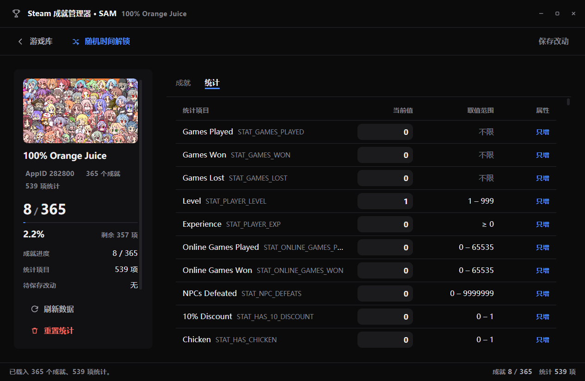
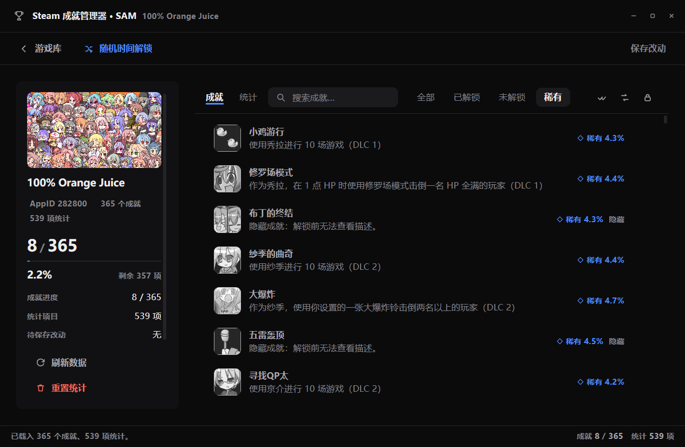
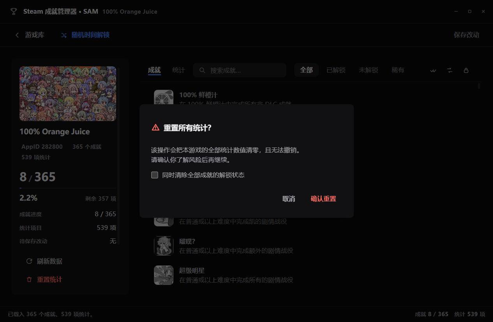

# SAM Modern · Steam 成就管理器（中文重构版）

> **本项目是 [gibbed/SteamAchievementManager](https://github.com/gibbed/SteamAchievementManager) 的二次修改版（非官方分支）。**
> 上游是一个用 WinForms 写的 Steam 成就 / 统计编辑工具，作者 Rick（gibbed）。我这里**保留并直接复用上游的 `SAM.API`**
> ——也就是全部与 Steam 客户端通信的底层逻辑——把*界面层*整个重写成 **WebView2 + HTML/CSS/JS**，
> 并做了**完整中文化**与一批交互改进（全量游戏目录、单窗口切换、批量暂存、进度环等）。
> 上游代码按 **zlib License** 授权，本仓库同样以 zlib License 发布，上游版权声明见 [LICENSE](LICENSE) 与
> `vendor/samsrc/SteamAchievementManager-master/LICENSE.txt`。上游项目本身与本仓库无关，问题请提到本仓库的 Issues。

一个把「Steam 成就 / 统计」变成可视化勾选列表的小工具：点开游戏 → 看到全部成就卡片 → 勾选 → 保存，改写的是
**你在 Steam 客户端本地的用户数据**（不上传、不联网写库）。

当前版本 **v1.8.0**：修复双击打开时多出一个黑色控制台窗口的问题 —— 程序此前按控制台子系统链接（`/target:exe`），Windows 会给它分配一个命令行窗口，关掉那个窗口等于给进程发 `CTRL_CLOSE`，工具也跟着退出。现在按 GUI 子系统（`/target:winexe`）链接，双击只出现应用窗口本身。

双仓同步发布：[GitHub](https://github.com/Knight003300/SAM-Modern) · [Gitee](https://gitee.com/arasy/SAM-Modern)（国内访问更快）。

---

## 截图

| 游戏库（含未安装游戏） | 成就管理 |
| --- | --- |
|  |  |

| 统计编辑 | 批量暂存（未保存标记） |
| --- | --- |
|  |  |

| 稀有成就筛选 | 随机时间解锁 |
| --- | --- |
|  |  |

| 重置确认 |
| --- |
|  |

---

## 功能

| 区域 | 说明 |
| --- | --- |
| 游戏库 | 与官方 SAM 一致：拉取 Steam 全量游戏目录（`games.xml`，约 9.4 万条）+ 逐项向 Steam 核对「是否已拥有」，因此**已购买但从未安装的游戏也会列出**；本机已安装但目录未收录的再用 `appmanifest` 补齐。卡片显示封面、类型标签与一行进度快照（本机记录过进度的显示「9 / 365 成就」，其余显示 `AppID`），支持搜索与「正式版 / 试玩 / 模组 / 其他」筛选 |
| 封面 | 候选链回落：本地 `appcache\librarycache`（header → capsule → hero → 600x900）→ Steam CDN → 字母占位。个别新游戏只有 `library_hero.jpg`，也能显示 |
| 成就页 | 行列表展示全部成就（图标、名称、描述、隐藏标记、解锁时间），点整行勾选切换状态；筛选栏的「稀有」一键只看全服解锁率低于 5% 的成就，右侧显示「稀有 x.x%」 |
| 批量操作 | 全选 / 反选 / 锁定全部 —— 只在界面内暂存，按「保存改动」或 `Ctrl+S` 才写入 Steam |
| 随机时间解锁 | 工具栏最左侧的蓝色按钮。按随机间隔逐个真实解锁：预设快速 5–15 秒 / 标准 15–45 秒 / 缓慢 60–180 秒，也可自定义最短–最长间隔（分别填**天 / 小时 / 分钟 / 秒**四个数值，单个间隔上限 7 天），弹窗会按「首个延迟 + (数量 − 1) × 间隔」实时估算整轮耗时区间（下限–上限，三档预设与自定义共用同一套算法），并写明过程中可随时停止、已解锁的不回退。每解锁一个立刻单独 `StoreStats()`，因此每个成就都由 Steam 记下各自的真实时间，不会全部挤在同一秒。解锁数量可选「全部剩余」或剩余数的 1/4、1/2、3/4（按实际成就数换算成具体个数显示）。「解锁范围」可只解锁稀有成就（全服解锁率 < 1% / < 5% / < 10% 三档，每档括号里显示当前可解锁个数），进度条实时显示，随时可停 |
| 统计页 | 可编辑数值表格，显示取值范围（`≥ 0`、`不限`）与「只增 / 受保护」标记 |
| 进度 | 左栏大数字 + 细进度条实时显示解锁进度（例 `91 / 200`、`45.5% · 剩余 109 项`）；下方事实区显示「最近解锁」与「稀有成就」两项，不再重复大数字与 AppID 行 |
| 重置 | 二次确认弹窗，可选「同时清除全部成就的解锁状态」 |
| 受保护成就 | 权限位含保护标记的成就自动跳过并提示，避免写入失败 |
| 单窗口 | 打开游戏 / 返回游戏库时不再弹出新窗口：旧进程把位置尺寸传给新进程，新窗口就绪后旧进程关闭，视觉上是一个窗口在切换。游戏库窗口进入游戏后**隐藏待命**（不退出），返回时直接唤回，连列表都不重扫 |
| 圆角 | Windows 11 走 DWM 圆角，旧系统回落 `SetWindowRgn` |

快捷键：`Ctrl+S` 保存、`Ctrl+F` 搜索、`Esc` 关闭弹窗 / 停止随机解锁 / 清空搜索 / 返回游戏库。

---

## 运行

从 [GitHub Releases](https://github.com/Knight003300/SAM-Modern/releases) 或 [Gitee Releases](https://gitee.com/arasy/SAM-Modern/releases) 下载 `SAM-Modern-zhCN.zip` 解压后双击 `SAM.Modern.exe` 即可（免安装、无依赖安装步骤）。国内网络建议走 Gitee。

```
SAM.Modern.exe            # 打开游戏库
SAM.Modern.exe 730        # 直接打开某个游戏（appId 就是商店链接里的数字，这里是 CS2）
```

前置条件：

1. 已安装 Steam 且已登录；
2. 已安装 **Microsoft Edge WebView2 运行时**（Win10/11 通常自带）；
3. 至少运行过一次要管理的游戏（Steam 才会生成 `appcache\stats\UserGameStatsSchema_<appid>.bin`）。

> **首次运行可能被 SmartScreen 拦一下**（「Windows 已保护你的电脑 / 发布者未知」）。这是微软对
> 「没有信誉记录的新程序」的统一提示，不是杀毒报警。点「更多信息 → 仍要运行」即可；
> 想彻底消掉需要上架 Microsoft Store 或购买代码签名证书并积累下载量，详见
> [使用说明 · 第七节](使用说明.md)。

---

## 自行构建

不需要安装 .NET SDK：仓库自带一套「下载即用」的离线工具链（Roslyn 编译器 + .NET Framework 4.8 参考程序集 + WebView2 SDK）。

```bash
node tools/fetch-ext.mjs     # 首次：从 nuget.org 下载离线工具链到 tools/ext（约 217MB，已被 .gitignore 忽略）
node tools/build.mjs api     # 编译 SAM.API.dll（上游 API 层）
node tools/build.mjs icon    # 生成 sam.ico
node tools/build.mjs ui      # 编译 SAM.Modern.exe，并复制 ui/ 与 WebView2 依赖到 build/
```

产物在 `build\`，整个目录可直接拷到别的机器运行。构建脚本会用 `tools/sign-one.ps1` 自动给 exe 打本机自签名
（没有证书时自动跳过，不阻断构建）。

> `node tools/build.mjs ui` 用 `/target:winexe` 链接（GUI 子系统）。不要改成 `exe`：那样编出来是控制台子系统，
> 双击运行时 Windows 会额外分配一个黑色控制台窗口，关掉它等于给进程发 `CTRL_CLOSE`，工具会一起退出。

---

## 目录结构

```
src/                    C# 主机层（.NET Framework 4.8，x86）
  Program.cs            入口与命令行参数解析
  WebShell.cs           无边框窗口外壳 + WebView2 初始化 + 虚拟主机映射 + 进程接力
  PickerForm.cs         游戏库页面（目录下载 + 订阅核对 + 封面解析）
  GameCatalog.cs        Steam 全量游戏目录（games.xml 下载 / 缓存 / 解析）
  GameForm.cs           成就/统计页面（读写 Steam 用户数据）
  GameData.cs           读取并解析 UserGameStatsSchema 二进制
  BinKV.cs              KeyValue 二进制解析器（对齐上游实现）
  Art.cs                封面候选链（本地缓存 → CDN → 占位）
  Relay.cs              「单窗口」进程接力的参数拼装与解析
  Bridge.cs             JS ⇄ C# 消息桥
  Json.cs               轻量 JSON 序列化 / 解析
  Log.cs                运行日志（sam-modern.log）
  SteamHost.cs          Steam 客户端封装与回调泵
ui/                     前端（原生 HTML/CSS/JS，无外部依赖、无 CDN）
  index.html / app.css / app.js
tools/
  build.mjs             Roslyn csc 直接编译，无需安装 .NET SDK
  fetch-ext.mjs         下载离线工具链
  sign-one.ps1 / sign.ps1 / unsign.ps1 / sync-dist.ps1
  icongen/IconGen.cs    应用图标生成器（紫蓝渐变奖杯，输出多尺寸 .ico）
vendor/samsrc/          上游 SteamAchievementManager 源码快照（zlib License）
docs-BRIDGE.md          JS ⇄ C# 协议说明（事件与命令表）
screenshots/            界面截图
```

---

## 与上游的差异

| | 上游 SAM | 本项目 |
| --- | --- | --- |
| 界面 | WinForms 原生控件 | WebView2 + HTML/CSS/JS，克制的深色中性风格 |
| 语言 | 英文 | 全中文 |
| 游戏列表 | 已安装的游戏 | Steam 全量目录 + 订阅核对（含未安装） |
| 切换游戏 | 新开一个窗口 | 单窗口内进程接力，无新窗口 |
| 批量操作 | 立即写入 | 界面内暂存，保存时一次性提交 |
| Steam 交互逻辑 | `SAM.API` | **直接复用上游 `SAM.API`**（未改动协议层） |

## 已知限制

- 只能修改**本地**用户数据；已被服务器端锁定的成就（受保护项）会跳过。
- 家庭共享的游戏成就无法写入（会提示「一般性错误」）。
- 换游戏必须换进程：`steamclient.dll` 在同一进程里只能绑定一个 appId，所以采用「进程接力」而不是真正的单进程切换。
- `vendor/` 里是上游源码快照，不参与构建（构建只编译 `src/` + `vendor/.../SAM.API`）。

## 更新日志

### v1.8.0

- **修复双击打开时多出一个黑色控制台窗口**。此前 `tools/build.mjs` 的界面构建用 `target: 'exe'`，C# 编译器据此链接出**控制台子系统**（PE Subsystem = 3）的程序；双击运行时 Windows 会为它分配一个控制台窗口，也就是那个黑框。
- **关掉黑框工具不会跟着退出了**：控制台窗口是进程的控制台，关掉它等于向进程发送 `CTRL_CLOSE`，于是主窗口一起消失。现在程序按 GUI 子系统（Subsystem = 2）链接，不再创建控制台。
- 程序本身不写 stdout（日志走同目录 `sam-modern.log`），所以改链接目标没有丢失任何诊断信息。
- 版本号升到 1.8.0。

### v1.7.0

- **游戏库卡片补一行进度快照**：卡片名称下面多一行 11px 次要信息。本机记录过进度的游戏显示「9 / 365 成就」，其余显示 `AppID 1091500`，任何情况下都有内容，不会出现空行错位。
- **左栏信息去重**：原来那三项（成就进度 / 统计项目 / 待保存改动）分别和左栏大数字、AppID 那一行、右上角保存按钮重复，现在换成「最近解锁」与「稀有成就」两项，取不到时显示 `—`。
- **随机时间解锁弹窗改成结果导向**：说明不再是「Steam 只认解锁那一刻的真实时间」这类实现原理，而是直接告诉你「将解锁 N 个成就、每两个之间随机等多久、预计耗时多长」，并写明过程中可以随时停止、已解锁的不会回退。
- **耗时预估改成区间且三档通用**：以前只有自定义间隔才估时，而且用「数量 × 平均间隔」把最后一个间隔也算进去了；现在内置三档和自定义都用同一套算法，按「首个延迟 + (数量 − 1) × 间隔」给出下限–上限区间。
- **「其中 N 个稀有」跟着解锁范围联动**：原来写死的是整个候选池的稀有数，切换到「稀有 < 1% / < 5% / < 10%」之后数字不会变；现在按当前范围实时统计，范围内全是稀有成就时直接说明。
- **保存按钮的待保存数量常驻**：徽标不再只在保存过程中出现，平时也显示当前有多少处改动（0 时用弱化色），按钮文案也随数量走。
- 版本号升到 1.7.0。

### v1.6.1

- **修复切换窗口时四边闪一圈白框**。点击游戏卡片切到游戏窗口的那几百毫秒里，窗口四边会出现一圈浅色（实测 `#F2F5FC`，宽 8px）的边框，页面首帧画出来之后才消失。
- 成因不是页面样式：`WS_THICKFRAME` 让 Windows 把窗口当成「可缩放窗口」，系统会在非客户区画一圈缩放边框；`WM_NCCALCSIZE` 只改布局矩形，挡不住 `WM_NCPAINT` 的绘制，于是这圈边框正好从无边框窗的 8px `Padding` 环里露出来。
- 修法：宿主接管非客户区绘制（`WM_NCPAINT` / `WM_NCACTIVATE` 直接不画），并给窗口声明深色支持（`DWMWA_USE_IMMERSIVE_DARK_MODE`）、把 DWM 边框色压到界面底色（`DWMWA_BORDER_COLOR`）；`WM_ERASEBKGND` 统一用界面底色填充，杜绝首帧浅色闪块。
- 保留全部既有行为：系统级放大/还原、双击标题栏、Aero Snap、四边拖动缩放都不受影响，最大化与还原尺寸仍然稳定。
- 版本号升到 1.6.1。

### v1.6.0

- **修复 Windows 11 下「窗口无法放大」**。无边框窗口此前只靠应用内按钮切 `WindowState`，系统级的放大手势全部失效：Win+↑ / Win+↓、双击标题栏、把窗口拖到屏幕顶部触发 Aero Snap 都没有反应。现在窗口重新带上 `WS_THICKFRAME`（也就恢复了系统缩放边框的语义），这四条路径全部可用。
- **最大化区域等于显示器工作区**：处理 `WM_GETMINMAXINFO`，最大化后窗口矩形严格等于任务栏以上的可用区域，不再盖住任务栏、也不在多显示器环境下跑到屏幕外。
- **去掉非客户区**：加了 `WS_THICKFRAME` 后系统会画一圈浅灰边框，用 `WM_NCCALCSIZE` 把客户区扩到整个窗口，边缘保持应用底色；圆角在最大化时自动取消。
- **修复「越还原越大」**：无边框窗下系统按「最大化矩形 − 边框」推算还原尺寸，边框为 0 于是每还原一次就大一圈（实测每次 +16px）。现在记录还原前的矩形，并用短命计时器连按几帧把系统随后改写的值纠正回来。
- **双击标题栏不再与拖动冲突**：标题栏改为指针移动超过阈值才进入系统拖动，双击（最大化/还原）和单击拖动可以共存。
- **最大化按钮图标跟随状态**：宿主新增 `{ev:"window", maximized}` 事件，按钮在「最大化 / 还原」两个图标之间切换。
- 启动尺寸与最小尺寸按当前显示器工作区夹紧，高 DPI 小屏幕上不会再出现窗口比屏幕还大的情况。
- 版本号升到 1.6.0。

### v1.5.0

- **界面重做**：以 Linear / Raycast 的信息密度为基准，删掉渐变、彩色语义色与「圆角 + 边框 + 阴影」三件套；层次只靠字号、字重、三级文字色和留白区分。全站统一 8px 圆角、4/8/12/16/24/32/48 间距刻度、4 档字号。
- 成就从**卡片网格改为行列表**：一行一个成就（图标 / 名称 / 描述 / 稀有度 / 勾选），同样面积能扫到更多条目，长列表不再逐张错峰入场。
- 左栏进度环换成**大数字 + 2px 细进度条**，同时显示百分比与剩余数量。
- 成就 / 统计切换、搜索、筛选与批量按钮从工具栏移进右栏内容头，工具栏只留「游戏库 / 随机时间解锁 / 保存改动」。
- 窗口变矮时左栏按优先级降级（先隐藏事实列表、再隐藏封面），保证按钮永远可见；窗口变窄时内容头自动换行。
- 弹窗正文独立滚动、按钮固定，长内容（自定义间隔）不再把按钮推出视口。
- 版本号升到 1.5.0。

### v1.4.0

- **切换速度**：打开游戏时新窗口在页面真正画完之后才显示、旧窗口随即退场；返回游戏库不再重启进程 —— 游戏库窗口进入待命（隐藏但不退出），返回时直接唤回，从约 870ms 降到几十毫秒。
- **不再闪骨架**：两个方向都先把上次的快照塞进 `ready` 事件里一次画完（成就 / 统计缓存在 `cache\game-<appId>.json`，游戏列表缓存在 `cache\owned.txt`），Steam 数据回来后再整表覆盖。
- 成就架构（schema）在窗口构造阶段就后台预读，Steam 回调到达时通常已经解析完成。
- 成就卡片改为**分块渲染**：首帧只排前 24 张，其余在首帧之后分批追加，首帧布局从约 223ms 降到约 92ms。
- 接力轮询间隔 60ms → 15ms；就绪文件改为「先写临时文件再改名」，父进程不会读到半截文件。
- 游戏库扫描新增进度推送（「已发现 N 个」）。
- 关闭游戏窗口时整个程序一起退出；游戏窗口被强行结束时，待命的游戏库窗口会自己回来。
- 版本号升到 1.4.0。

### v1.3.1

- 修复**返回游戏库后 Steam 仍把游戏显示为「运行中」**。原因是「进程接力」时子进程会继承父进程环境变量里的 `SteamAppId`，而 `SAM.API` 的 `Client.Initialize(0)` 只设不清，于是游戏库进程仍以旧 appId 连接 `steamclient.dll`，Steam 客户端就认为那个游戏还在跑。现在 appId 为 0 时会显式清除 `SteamAppId`，并在窗口关闭时主动释放 Steam 管道。
- 版本号升到 1.3.1。

### v1.3.0

- 界面重做为**克制的深色风格**：中性灰阶 + 单一系统蓝作为强调色，圆角与控件高度整体收小，去掉彩色渐变、光晕和卡片入场动画。
- 性能：去掉标题栏 / 工具栏 / 状态栏 / 卡片 / 侧栏 / 面板 / 弹窗上的 9 处 `backdrop-filter` 与两团常驻 `blur(90px)` 背景动画，改为静态单层背景；低配机器滚动明显更稳。
- 性能：**修复游戏库扫描卡死**。原来 `cache\games.xml` 超过 24 小时就必须联网重新下载，而下载用的 `WebClient` 没有任何超时，遇到源站半死会一直转圈。现在改为 stale-while-revalidate：旧缓存先用起来，过期才在后台线程限时刷新（12 秒超时）。
- 性能：搜索框加了 120ms 防抖（回车 / 清空仍然立即生效），逐字输入不再每次都重建整个网格。
- 版本号升到 1.3.0。

### v1.2.0

- 新增**稀有成就筛选**：成就页筛选栏多了「稀有」，一键只看全服解锁率低于 5% 的成就；每张稀有卡带金色「稀有 x.x%」标记。
- 随机时间解锁新增**解锁范围**：可选「全部成就」或「稀有 < 1% / < 5% / < 10%」三档，每档括号里实时显示当前还能解锁几个，数量分档会跟着范围重新换算。
- 稀有度来自 Steam 客户端的原生接口（`RequestGlobalAchievementPercentages` + `GetAchievementAchievedPercent`），不经过任何第三方服务器，也不额外联网写入。
- 版本号升到 1.2.0。

### v1.1.0

- 新增**随机时间解锁**：工具栏最左侧的紫色按钮。Steam 的公共 API 没有「写解锁时间」的函数（解锁时间由 Steam 在提交时按当时系统时间记录，见上游 [issue #534](https://github.com/gibbed/SteamAchievementManager/issues/534)），所以这里改成按随机间隔**逐个真实解锁**、每解锁一个立刻单独 `StoreStats()`，从而让每个成就拿到不同的真实时间。
- 解锁数量按剩余数分档：全部剩余 / 剩余数的 1/4、1/2、3/4，按钮上直接显示换算后的个数。
- 解锁间隔可选预设（快速 5–15 秒 / 标准 15–45 秒 / 缓慢 60–180 秒），也可自定义「天 / 小时 / 分钟 / 秒」四段数值，单个间隔上限 7 天；弹窗实时估算整轮耗时。
- 解锁过程有进度条与下一个成就的倒计时，随时可停止（点「停止」或按 `Esc`）。
- 工具栏的批量按钮（全选 / 反选 / 锁定全部）改为图标按钮，给新入口腾出空间。

### v1.0.0

- 首个公开版本：界面整体重写为 WebView2 + HTML/CSS/JS 深色玻璃拟态风格并完整中文化；全量游戏目录、封面候选链回落、单窗口切换、批量暂存 + `Ctrl+S` 提交、窗口圆角与进度环。

---

## 许可与致谢

- 本仓库：**zlib License**，见 [LICENSE](LICENSE)。
- 上游：[gibbed/SteamAchievementManager](https://github.com/gibbed/SteamAchievementManager)，Copyright (c) 2024 Rick (rick 'at' gibbed 'dot' us)，zlib License。
- 界面协议说明见 [docs-BRIDGE.md](docs-BRIDGE.md)，终端用户手册见 [使用说明.md](使用说明.md)。