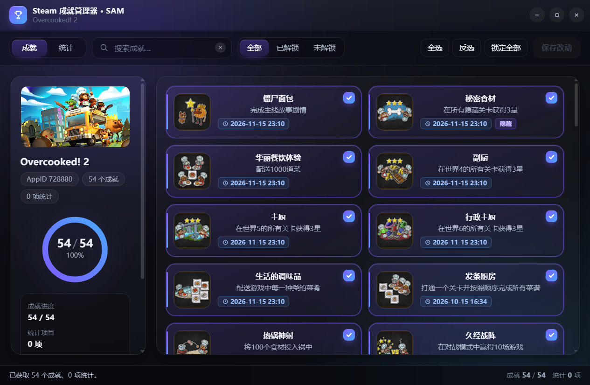
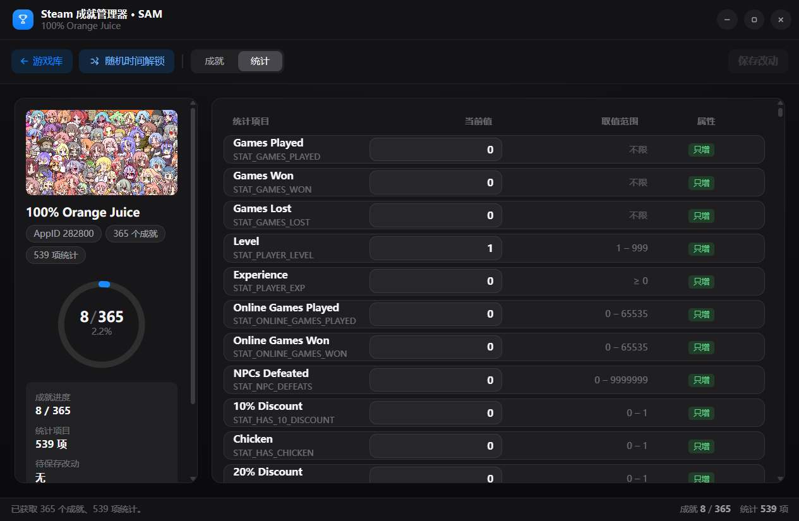
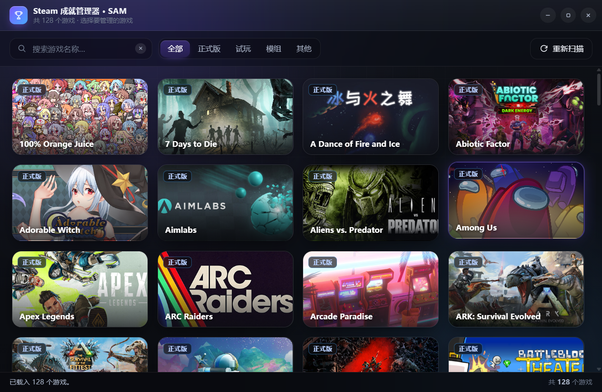
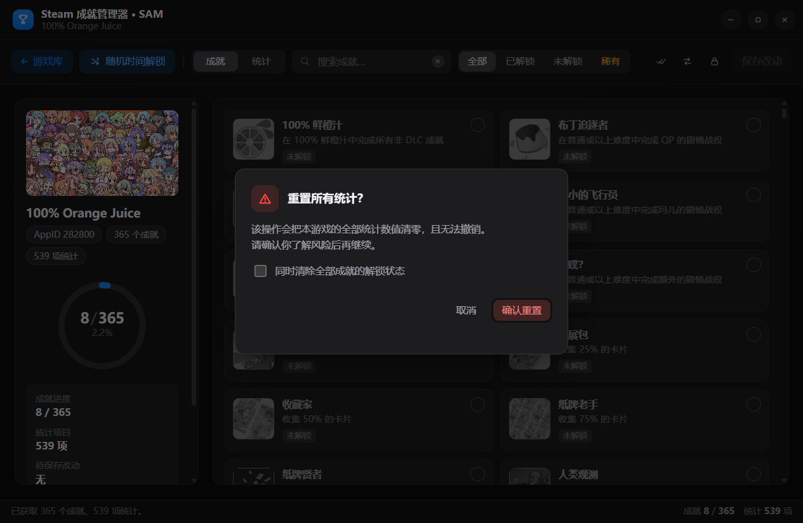

# SAM Modern · Steam 成就管理器（中文重构版）

> **本项目是 [gibbed/SteamAchievementManager](https://github.com/gibbed/SteamAchievementManager) 的二次修改版（非官方分支）。**
> 上游是一个用 WinForms 写的 Steam 成就 / 统计编辑工具，作者 Rick（gibbed）。我这里**保留并直接复用上游的 `SAM.API`**
> ——也就是全部与 Steam 客户端通信的底层逻辑——把*界面层*整个重写成 **WebView2 + HTML/CSS/JS**，
> 并做了**完整中文化**与一批交互改进（全量游戏目录、单窗口切换、批量暂存、进度环等）。
> 上游代码按 **zlib License** 授权，本仓库同样以 zlib License 发布，上游版权声明见 [LICENSE](LICENSE) 与
> `vendor/samsrc/SteamAchievementManager-master/LICENSE.txt`。上游项目本身与本仓库无关，问题请提到本仓库的 Issues。

一个把「Steam 成就 / 统计」变成可视化勾选列表的小工具：点开游戏 → 看到全部成就卡片 → 勾选 → 保存，改写的是
**你在 Steam 客户端本地的用户数据**（不上传、不联网写库）。

---

## 截图

| 游戏库 | 成就管理 |
| --- | --- |
|  |  |

| 统计编辑 | 批量暂存 |
| --- | --- |
|  |  |

| 全量目录（含未安装游戏） | 重置确认 |
| --- | --- |
|  |  |

其余截图见 [screenshots/](screenshots)。

---

## 功能

| 区域 | 说明 |
| --- | --- |
| 游戏库 | 与官方 SAM 一致：拉取 Steam 全量游戏目录（`games.xml`，约 9.4 万条）+ 逐项向 Steam 核对「是否已拥有」，因此**已购买但从未安装的游戏也会列出**；本机已安装但目录未收录的再用 `appmanifest` 补齐。卡片显示封面与类型标签，支持搜索与「正式版 / 试玩 / 模组 / 其他」筛选 |
| 封面 | 候选链回落：本地 `appcache\librarycache`（header → capsule → hero → 600x900）→ Steam CDN → 字母占位。个别新游戏只有 `library_hero.jpg`，也能显示 |
| 成就页 | 卡片网格展示全部成就（名称、描述、隐藏标记、解锁时间），单卡勾选切换状态 |
| 批量操作 | 全选 / 反选 / 锁定全部 —— 只在界面内暂存，按「保存改动」或 `Ctrl+S` 才写入 Steam |
| 统计页 | 可编辑数值表格，显示取值范围（`≥ 0`、`不限`）与「只增 / 受保护」标记 |
| 进度环 | 左侧实时显示解锁进度（例 `91 / 200 · 45.5%`） |
| 重置 | 二次确认弹窗，可选「同时清除全部成就的解锁状态」 |
| 受保护成就 | 权限位含保护标记的成就自动跳过并提示，避免写入失败 |
| 单窗口 | 打开游戏 / 返回游戏库时不再弹出新窗口：旧进程把位置尺寸传给新进程，新窗口就绪后旧进程关闭，视觉上是一个窗口在切换 |
| 圆角 | Windows 11 走 DWM 圆角，旧系统回落 `SetWindowRgn`，10px |

快捷键：`Ctrl+S` 保存、`Ctrl+F` 搜索、`Esc` 关闭弹窗 / 清空搜索 / 返回游戏库。

---

## 运行

从 [Releases](../../releases) 下载 `SAM-Modern-zhCN.zip` 解压后双击 `SAM.Modern.exe` 即可（免安装、无依赖安装步骤）。

```
SAM.Modern.exe            # 打开游戏库
SAM.Modern.exe 730        # 直接打开某个游戏（appId 就是商店链接里的数字，这里是 CS2）
```

前置条件：

1. 已安装 Steam 且已登录；
2. 已安装 **Microsoft Edge WebView2 运行时**（Win10/11 通常自带）；
3. 至少运行过一次要管理的游戏（Steam 才会生成 `appcache\stats\UserGameStatsSchema_<appid>.bin`）。

> **首次运行可能被 SmartScreen 拦一下**（「Windows 已保护你的电脑 / 发布者未知」）。这是微软对
> 「没有信誉记录的新程序」的统一提示，不是杀毒报警。点「更多信息 → 仍要运行」即可；
> 想彻底消掉需要上架 Microsoft Store 或购买代码签名证书并积累下载量，详见
> [使用说明 · 第七节](使用说明.md)。

---

## 自行构建

不需要安装 .NET SDK：仓库自带一套「下载即用」的离线工具链（Roslyn 编译器 + .NET Framework 4.8 参考程序集 + WebView2 SDK）。

```bash
node tools/fetch-ext.mjs     # 首次：从 nuget.org 下载离线工具链到 tools/ext（约 217MB，已被 .gitignore 忽略）
node tools/build.mjs api     # 编译 SAM.API.dll（上游 API 层）
node tools/build.mjs icon    # 生成 sam.ico
node tools/build.mjs ui      # 编译 SAM.Modern.exe，并复制 ui/ 与 WebView2 依赖到 build/
```

产物在 `build\`，整个目录可直接拷到别的机器运行。构建脚本会用 `tools/sign-one.ps1` 自动给 exe 打本机自签名
（没有证书时自动跳过，不阻断构建）。

---

## 目录结构

```
src/                    C# 主机层（.NET Framework 4.8，x86）
  Program.cs            入口与命令行参数解析
  WebShell.cs           无边框窗口外壳 + WebView2 初始化 + 虚拟主机映射 + 进程接力
  PickerForm.cs         游戏库页面（目录下载 + 订阅核对 + 封面解析）
  GameCatalog.cs        Steam 全量游戏目录（games.xml 下载 / 缓存 / 解析）
  GameForm.cs           成就/统计页面（读写 Steam 用户数据）
  GameData.cs           读取并解析 UserGameStatsSchema 二进制
  BinKV.cs              KeyValue 二进制解析器（对齐上游实现）
  Art.cs                封面候选链（本地缓存 → CDN → 占位）
  Relay.cs              「单窗口」进程接力的参数拼装与解析
  Bridge.cs             JS ⇄ C# 消息桥
  Json.cs               轻量 JSON 序列化 / 解析
  Log.cs                运行日志（sam-modern.log）
  SteamHost.cs          Steam 客户端封装与回调泵
ui/                     前端（原生 HTML/CSS/JS，无外部依赖、无 CDN）
  index.html / app.css / app.js
tools/
  build.mjs             Roslyn csc 直接编译，无需安装 .NET SDK
  fetch-ext.mjs         下载离线工具链
  sign-one.ps1 / sign.ps1 / unsign.ps1 / sync-dist.ps1
  icongen/IconGen.cs    应用图标生成器（紫蓝渐变奖杯，输出多尺寸 .ico）
vendor/samsrc/          上游 SteamAchievementManager 源码快照（zlib License）
docs-BRIDGE.md          JS ⇄ C# 协议说明（事件与命令表）
screenshots/            界面截图
```

---

## 与上游的差异

| | 上游 SAM | 本项目 |
| --- | --- | --- |
| 界面 | WinForms 原生控件 | WebView2 + HTML/CSS/JS，深色玻璃拟态 |
| 语言 | 英文 | 全中文 |
| 游戏列表 | 已安装的游戏 | Steam 全量目录 + 订阅核对（含未安装） |
| 切换游戏 | 新开一个窗口 | 单窗口内进程接力，无新窗口 |
| 批量操作 | 立即写入 | 界面内暂存，保存时一次性提交 |
| Steam 交互逻辑 | `SAM.API` | **直接复用上游 `SAM.API`**（未改动协议层） |

## 已知限制

- 只能修改**本地**用户数据；已被服务器端锁定的成就（受保护项）会跳过。
- 家庭共享的游戏成就无法写入（会提示「一般性错误」）。
- 换游戏必须换进程：`steamclient.dll` 在同一进程里只能绑定一个 appId，所以采用「进程接力」而不是真正的单进程切换。
- `vendor/` 里是上游源码快照，不参与构建（构建只编译 `src/` + `vendor/.../SAM.API`）。

## 许可与致谢

- 本仓库：**zlib License**，见 [LICENSE](LICENSE)。
- 上游：[gibbed/SteamAchievementManager](https://github.com/gibbed/SteamAchievementManager)，Copyright (c) 2024 Rick (rick 'at' gibbed 'dot' us)，zlib License。
- 界面协议说明见 [docs-BRIDGE.md](docs-BRIDGE.md)，终端用户手册见 [使用说明.md](使用说明.md)。