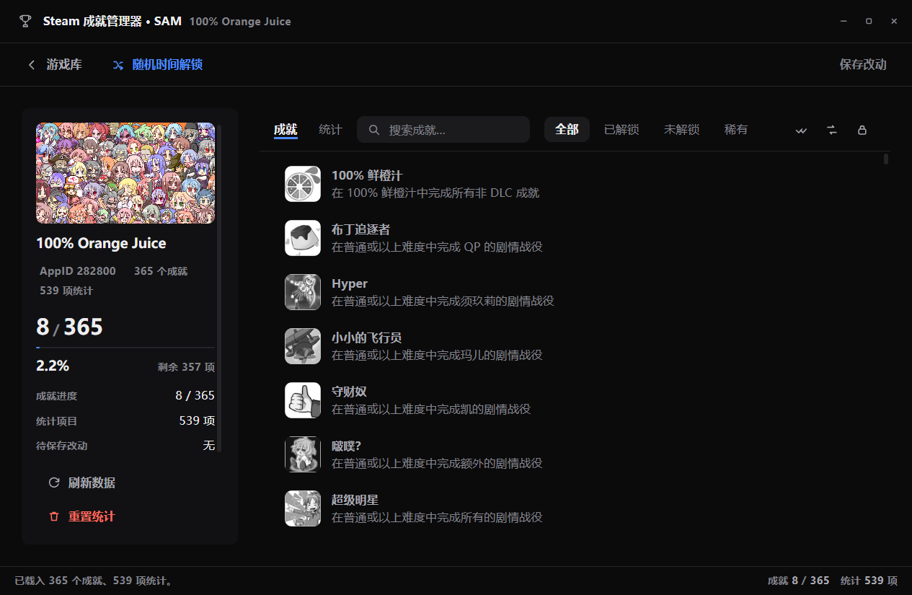
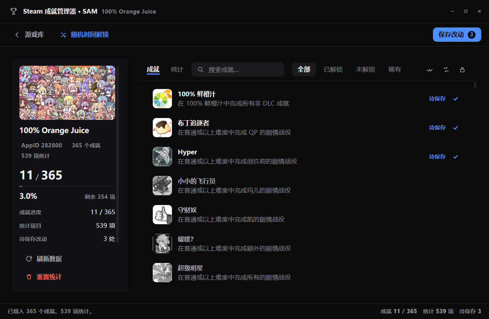
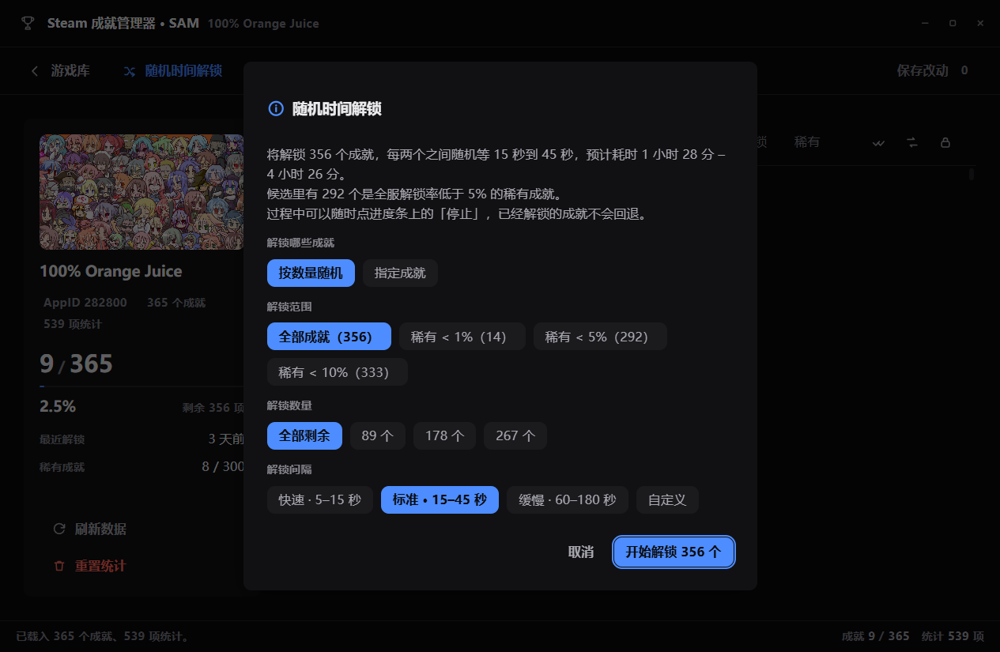
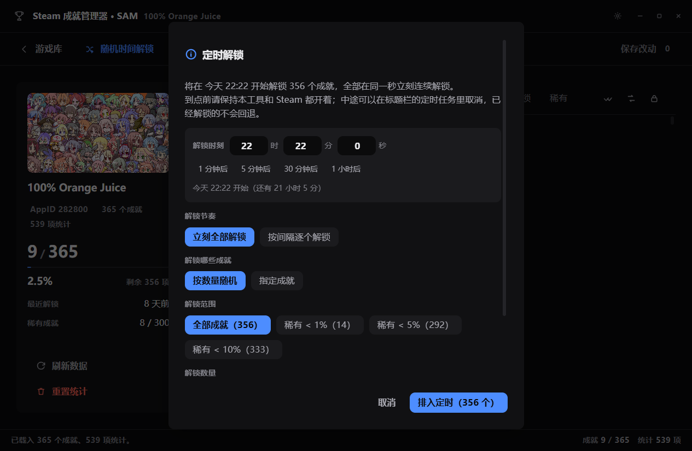
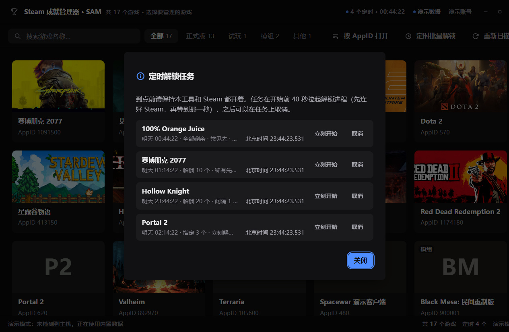
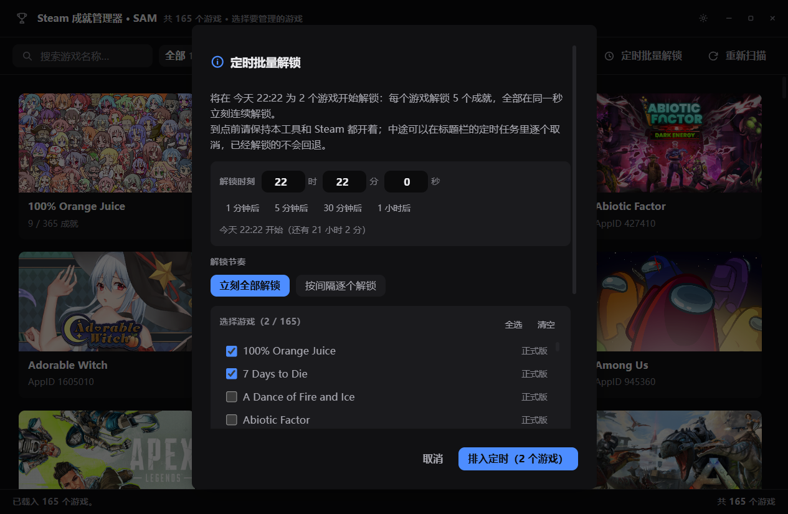
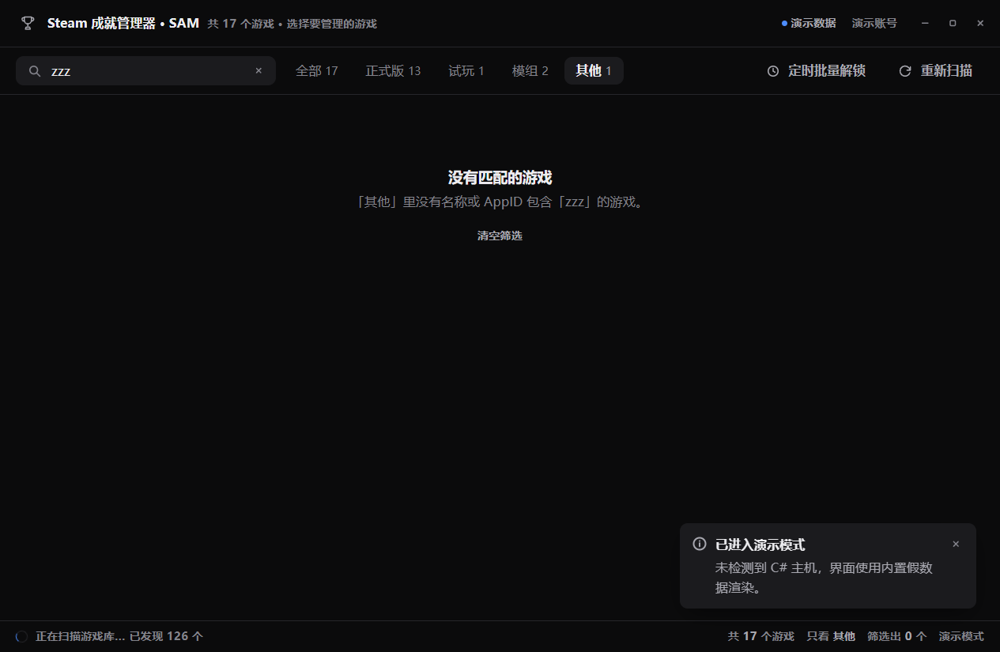
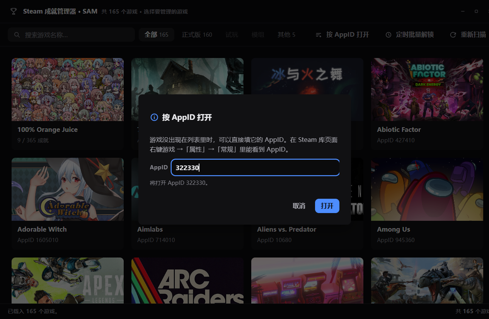

# SAM Modern · Steam 成就管理器（中文重构版）

> **本项目是 [gibbed/SteamAchievementManager](https://github.com/gibbed/SteamAchievementManager) 的二次修改版（非官方分支）。**
> 上游是一个用 WinForms 写的 Steam 成就 / 统计编辑工具，作者 Rick（gibbed）。我这里**保留并直接复用上游的 `SAM.API`**
> ——也就是全部与 Steam 客户端通信的底层逻辑——把*界面层*整个重写成 **WebView2 + HTML/CSS/JS**，
> 并做了**完整中文化**与一批交互改进（全量游戏目录、单窗口切换、批量暂存、进度环等）。
> 上游代码按 **zlib License** 授权，本仓库同样以 zlib License 发布，上游版权声明见 [LICENSE](LICENSE) 与
> `vendor/samsrc/SteamAchievementManager-master/LICENSE.txt`。上游项目本身与本仓库无关，问题请提到本仓库的 Issues。

一个把「Steam 成就 / 统计」变成可视化勾选列表的小工具：点开游戏 → 看到全部成就卡片 → 勾选 → 保存，改写的是
**你在 Steam 客户端本地的用户数据**（不上传、不联网写库）。

当前版本 **v1.9.11**：把三个定时弹窗的**操作路径重排**了一遍 —— 「立刻解锁」从「间隔」里的一档提升为独立的**「解锁节奏」**（选立刻时整个间隔组收起），「解锁时刻」多了**「1 分钟后 / 5 分钟后 / 30 分钟后 / 1 小时后」**四个相对时间快捷项，批量弹窗的「选择游戏」提到了最前面（原来是夹在模式和成就列表中间）。同时把进度条从动 `width` 改成动 `transform`、成就列表交给 `content-visibility` 一次渲染完、骨架屏换成扫光、滚动条最后一处硬编码色值换成 token。

双仓同步发布：[GitHub](https://github.com/Knight003300/SAM-Modern) · [Gitee](https://gitee.com/arasy/SAM-Modern)（国内访问更快）。

---

## 截图

| 游戏库（含未安装游戏） | 成就管理 |
| --- | --- |
|  |  |

| 统计编辑 | 批量暂存（未保存标记） |
| --- | --- |
|  |  |

| 稀有成就筛选 | 随机时间解锁 |
| --- | --- |
|  |  |

| 定时解锁 | 定时任务列表 |
| --- | --- |
|  |  |

| 定时批量解锁（逐游戏指定成就） | 类型筛选（带数量 · 空态说明） |
| --- | --- |
|  |  |

| 设置 | 关于（检查更新） | 赞赏作者 |
| --- | --- | --- |
|  |  |  |

| 按 AppID 打开（扫不到的游戏） | 未在库中（本机有痕迹但账号没拥有） |
| --- | --- |
|  |  |

| 重置确认 |
| --- |
|  |

---

## 功能

| 区域 | 说明 |
| --- | --- |
| 游戏库 | 与官方 SAM 一致：拉取 Steam 全量游戏目录（`games.xml`，约 9.4 万条）+ 逐项向 Steam 核对「是否已拥有」，因此**已购买但从未安装的游戏也会列出**；本机已安装但目录未收录的再用 `appmanifest` 补齐。**扫描不只依赖 Steam 的「已订阅」状态**：还会读本机痕迹（`appcache\stats\UserGameStatsSchema_*.bin` 成就架构、`appmanifest_*.acf`、`appcache\librarycache`、`userdata\config\localconfig.vdf`）把漏掉的补进来，实测本机从 129 个补到 165 个；补出来的条目如果 Steam 说当前账号没拥有（家庭共享被收回、免费周末结束、已退款），卡片会带红色「未在库中」标签并在悬停提示里说明原因。卡片显示封面、类型标签与一行进度快照（本机记录过进度的显示「9 / 365 成就」，其余显示 `AppID`），支持搜索与「正式版 / 试玩 / 模组 / 其他」筛选；类型段控每档后面带游戏数量，数量为 0 的档位置灰不可点，选过的类型下次开窗仍然生效，状态栏会标出「只看 试玩」，空列表区分「没搜到」和「这类本来就没有」并给一个「清空筛选」按钮。工具栏还有**「按 AppID 打开」**：仍然扫不到的游戏可以直接填 AppID 进去（Steam 库页面右键游戏 →「属性」→「常规」里能看到） |
| 封面 | 候选链回落：本地 `appcache\librarycache`（header → capsule → hero → 600x900）→ Steam CDN → 字母占位。个别新游戏只有 `library_hero.jpg`，也能显示 |
| 成就页 | 行列表展示全部成就（图标、名称、描述、隐藏标记、解锁时间），点整行勾选切换状态；筛选栏的「稀有」一键只看全服解锁率低于 5% 的成就，右侧显示「稀有 x.x%」 |
| 批量操作 | 全选 / 反选 / 锁定全部 —— 只在界面内暂存，按「保存改动」或 `Ctrl+S` 才写入 Steam |
| 定时解锁 | 把解锁时间定在某个具体的**时:分:秒**（秒可以填 0–59 任意值，直接填数字）：游戏页工具栏「定时解锁」填好时刻、选好节奏、点「排入定时」即可。时刻旁边有**「1 分钟后 / 5 分钟后 / 30 分钟后 / 1 小时后」**四个快捷项，按当前时间算，不用自己算钟点。解锁内容有两种模式：**按数量随机**（选范围与数量，由后台自己挑）或**指定成就**（在成就列表里勾选具体要解锁的那几个，带搜索框与全选 / 清空，按勾选顺序依次解锁）。按数量随机时还能选**「解锁顺序」**：随机顺序（默认）、常见 → 稀有、稀有 → 常见 —— 后两者按全服解锁率排队，间隔照旧随机。「解锁节奏」是一层独立选择：**「立刻全部解锁」**（默认，到点后不再等，多个成就挤在同一秒连续写入）或**「按间隔逐个解锁」**（下面再选快 / 标准 / 慢三档间隔；选立刻时整组间隔收起）。到点前 40 秒由宿主拉起一个隐藏的解锁进程，它会先连好 Steam 备好数据，再等到那一秒精确开跑。任务存在程序目录 `schedule\` 下，关掉再开仍在；标题栏会出现「N 个定时 · HH:mm」的 chip（时刻带秒时显示 HH:mm:ss），点开可看倒计时并取消。**到点时本工具必须还开着、Steam 要在运行**，否则任务不会执行 |
| 定时批量解锁 | 游戏库工具栏的「定时批量解锁」：先勾选任意多个游戏（**选游戏在弹窗最上面**，全选 / 清空都在旁边），再定一个共同时刻与节奏，它们会在**同一秒**各自开始（每个游戏一个独立后台进程并行，互不阻塞）。解锁内容同样两种模式：**按数量随机**（每个游戏各解锁 N 个，可再选解锁顺序：随机 / 常见 → 稀有 / 稀有 → 常见）或**指定成就** —— 选后者先挑游戏，再**逐个游戏分别勾选**它要解锁的成就（顶部一排游戏按钮显示各勾了几个，点着切换着配），所以可以「今晚 22:22:00 把 A 游戏的这 3 个、B 游戏的那 2 个一起解锁」 |
| 随机时间解锁 | 工具栏最左侧的蓝色按钮。两种模式：**按数量随机**（默认）或**指定成就**（勾选具体成就后按顺序解锁）。按随机间隔逐个真实解锁：预设快速 5–15 秒 / 标准 15–45 秒 / 缓慢 60–180 秒，也可自定义最短–最长间隔（分别填**天 / 小时 / 分钟 / 秒**四个数值，单个间隔上限 7 天），弹窗会按「首个延迟 + (数量 − 1) × 间隔」实时估算整轮耗时区间（下限–上限，三档预设与自定义共用同一套算法），并写明过程中可随时停止、已解锁的不回退。每解锁一个立刻单独 `StoreStats()`，因此每个成就都由 Steam 记下各自的真实时间，不会全部挤在同一秒。解锁数量可选「全部剩余」或剩余数的 1/4、1/2、3/4（按实际成就数换算成具体个数显示）。「解锁范围」可只解锁稀有成就（全服解锁率 < 1% / < 5% / < 10% 三档，每档括号里显示当前可解锁个数）。「解锁顺序」可选**随机顺序**（默认）、**常见 → 稀有**（全服解锁率高的先解锁，最稀有的压到最后）或**稀有 → 常见**（反过来），间隔仍然随机，所以整轮看起来还是「随机时间」解锁，只是先后有讲究；选「指定成就」时顺序就是你勾选的顺序，这一组会自动隐藏。进度条实时显示，随时可停 |
| 统计页 | 可编辑数值表格，显示取值范围（`≥ 0`、`不限`）与「只增 / 受保护」标记 |
| 进度 | 左栏大数字 + 细进度条实时显示解锁进度（例 `91 / 200`、`45.5% · 剩余 109 项`）；下方事实区显示「最近解锁」与「稀有成就」两项，不再重复大数字与 AppID 行 |
| 重置 | 二次确认弹窗，可选「同时清除全部成就的解锁状态」 |
| 受保护成就 | 权限位含保护标记的成就自动跳过并提示，避免写入失败 |
| 设置 / 关于 | 标题栏右侧的齿轮按钮打开「设置」，四行：**关于**、**检查更新**（就地显示「正在检查更新… / 已是最新版本 vX / 发现新版本 vX · 点一下打开发布页 / 检查失败 · 点一下重试」）、项目主页、下载最新版。打开设置会自动查一次更新；15 秒没回音自己收尾，不会一直卡在检查中。检查中那一行只是变灰不响应，**不置 `disabled`**，所以焦点不会掉到窗口外。「关于」里还有版本号与**「赞赏作者」**。「检查更新」去 GitHub 拉最新 release 与本地版本逐段比较（`v1.9.10 > v1.9.9`，不是字符串比大小），有新版给出「打开发布页」，用系统默认浏览器打开。**设置 → 关于 → 赞赏**是一个能层层退回的层级：Esc 退一层、Tab 焦点困在弹窗内、从哪一行进去退回来焦点就落回哪一行，关掉设置回到齿轮。真实运行时版本号由 C# 的 `AppInfo.Version` 通过 `appInfo` 事件下发；JS 里那份只给演示模式兜底 |
| 赞赏作者 | 「关于」里的「赞赏作者」打开一个弹窗，并排展示**支付宝收款码**与**微信赞赏码**，扫码即可，不用加好友 |
| 单窗口 | 打开游戏 / 返回游戏库时不再弹出新窗口：旧进程把位置尺寸传给新进程，新窗口就绪后旧进程关闭，视觉上是一个窗口在切换。游戏库窗口进入游戏后**隐藏待命**（不退出），返回时直接唤回，连列表都不重扫 |
| 圆角 | Windows 11 走 DWM 圆角，旧系统回落 `SetWindowRgn` |

快捷键：`Ctrl+S` 保存、`Ctrl+F` 搜索、`Esc` 关闭弹窗 / 停止随机解锁 / 清空搜索 / 返回游戏库。

---

## 运行

从 [GitHub Releases](https://github.com/Knight003300/SAM-Modern/releases) 或 [Gitee Releases](https://gitee.com/arasy/SAM-Modern/releases) 下载 `SAM-Modern-zhCN.zip` 解压后双击 `SAM.Modern.exe` 即可（免安装、无依赖安装步骤）。国内网络建议走 Gitee。

```
SAM.Modern.exe            # 打开游戏库
SAM.Modern.exe 730        # 直接打开某个游戏（appId 就是商店链接里的数字，这里是 CS2）
```

前置条件：

1. 已安装 Steam 且已登录；
2. 已安装 **Microsoft Edge WebView2 运行时**（Win10/11 通常自带）；
3. 至少运行过一次要管理的游戏（Steam 才会生成 `appcache\stats\UserGameStatsSchema_<appid>.bin`）。

> **首次运行可能被 SmartScreen 拦一下**（「Windows 已保护你的电脑 / 发布者未知」）。这是微软对
> 「没有信誉记录的新程序」的统一提示，不是杀毒报警。点「更多信息 → 仍要运行」即可；
> 想彻底消掉需要上架 Microsoft Store 或购买代码签名证书并积累下载量，详见
> [使用说明 · 第七节](使用说明.md)。

---

## 自行构建

不需要安装 .NET SDK：仓库自带一套「下载即用」的离线工具链（Roslyn 编译器 + .NET Framework 4.8 参考程序集 + WebView2 SDK）。

```bash
node tools/fetch-ext.mjs     # 首次：从 nuget.org 下载离线工具链到 tools/ext（约 217MB，已被 .gitignore 忽略）
node tools/build.mjs api     # 编译 SAM.API.dll（上游 API 层）
node tools/build.mjs icon    # 生成 sam.ico
node tools/build.mjs ui      # 编译 SAM.Modern.exe，并复制 ui/ 与 WebView2 依赖到 build/
```

产物在 `build\`，整个目录可直接拷到别的机器运行。构建脚本会用 `tools/sign-one.ps1` 自动给 exe 打本机自签名
（没有证书时自动跳过，不阻断构建）。

> `node tools/build.mjs ui` 用 `/target:winexe` 链接（GUI 子系统）。不要改成 `exe`：那样编出来是控制台子系统，
> 双击运行时 Windows 会额外分配一个黑色控制台窗口，关掉它等于给进程发 `CTRL_CLOSE`，工具会一起退出。

---

## 目录结构

```
src/                    C# 主机层（.NET Framework 4.8，x86）
  Program.cs            入口与命令行参数解析
  WebShell.cs           无边框窗口外壳 + WebView2 初始化 + 虚拟主机映射 + 进程接力
  PickerForm.cs         游戏库页面（目录下载 + 订阅核对 + 封面解析）
  GameCatalog.cs        Steam 全量游戏目录（games.xml 下载 / 缓存 / 解析）
  GameForm.cs           成就/统计页面（读写 Steam 用户数据）
  GameData.cs           读取并解析 UserGameStatsSchema 二进制
  BinKV.cs              KeyValue 二进制解析器（对齐上游实现）
  Art.cs                封面候选链（本地缓存 → CDN → 占位）
  Relay.cs              「单窗口」进程接力的参数拼装与解析
  Schedule.cs           定时解锁任务的文件存储与调度器（每个窗口进程一份，用独占文件互斥）
  ScheduleWorker.cs     定时解锁的后台执行体（--run-job，只做 SetAchievement + StoreStats，不建窗口）
  AppInfo.cs            版本号 + 检查更新（GitHub releases API）+ 用系统浏览器打开链接
  Bridge.cs             JS ⇄ C# 消息桥
  Json.cs               轻量 JSON 序列化 / 解析
  Log.cs                运行日志（sam-modern.log）
  SteamHost.cs          Steam 客户端封装与回调泵
ui/                     前端（原生 HTML/CSS/JS，无外部依赖、无 CDN）
  index.html / app.css / app.js
  reward-alipay.jpg     支付宝收款码（「关于 → 赞赏作者」里显示）
  reward-wechat.png     微信赞赏码（同上）
tools/
  build.mjs             Roslyn csc 直接编译，无需安装 .NET SDK
  fetch-ext.mjs         下载离线工具链
  sign-one.ps1 / sign.ps1 / unsign.ps1 / sync-dist.ps1
  icongen/IconGen.cs    应用图标生成器（紫蓝渐变奖杯，输出多尺寸 .ico）
vendor/samsrc/          上游 SteamAchievementManager 源码快照（zlib License）
docs-BRIDGE.md          JS ⇄ C# 协议说明（事件与命令表）
screenshots/            界面截图
```

---

## 与上游的差异

| | 上游 SAM | 本项目 |
| --- | --- | --- |
| 界面 | WinForms 原生控件 | WebView2 + HTML/CSS/JS，克制的深色中性风格 |
| 语言 | 英文 | 全中文 |
| 游戏列表 | 已安装的游戏 | Steam 全量目录 + 订阅核对（含未安装） |
| 切换游戏 | 新开一个窗口 | 单窗口内进程接力，无新窗口 |
| 批量操作 | 立即写入 | 界面内暂存，保存时一次性提交 |
| Steam 交互逻辑 | `SAM.API` | **直接复用上游 `SAM.API`**（未改动协议层） |

## 已知限制

- 只能修改**本地**用户数据；已被服务器端锁定的成就（受保护项）会跳过。
- 家庭共享的游戏成就无法写入（会提示「一般性错误」）。这类游戏现在会出现在列表里并带「未在库中」标签，看得见但存不进去。
- 扫描以**本机痕迹**为准：游戏必须在这台电脑上装过或跑过（哪怕只启动过一次），才会有成就架构 / 安装记录可查。纯云端、从没在这台机器上出现过的游戏扫不出来，请用工具栏的「按 AppID 打开」手动进入。
- 换游戏必须换进程：`steamclient.dll` 在同一进程里只能绑定一个 appId，所以采用「进程接力」而不是真正的单进程切换；定时解锁也因此给每个游戏单独起一个隐藏的解锁进程。
- 定时解锁需要**到点时本工具仍在运行**（最小化 / 隐藏待命都可以）且 Steam 在线；工具退出后任务不会执行。任务只在本地排队，不会托管到任何服务器。
- `vendor/` 里是上游源码快照，不参与构建（构建只编译 `src/` + `vendor/.../SAM.API`）。

## 更新日志

### v1.9.11

- **「立刻解锁」提成独立一层「解锁节奏」**：以前它藏在「解锁间隔」里当一档，跟「快速 5–15 秒」并排，读起来像「间隔 0 秒」。现在节奏单独一组 —— **立刻全部解锁**（默认）或**按间隔逐个解锁**；选立刻时下面那组间隔整组收起，不用读一组用不上的按钮。
- **「解锁时刻」加了相对时间快捷项**：`1 分钟后 / 5 分钟后 / 30 分钟后 / 1 小时后`。以前要解锁「过五分钟」得自己算「现在几点加五分钟」再填三个框，现在点一下就把时 / 分 / 秒按当前时间填好（秒会向上取整兜掉边界）。
- **定时弹窗的组顺序重排**：按「先决定什么，再决定细节」排 —— 时刻 → 节奏 → 解锁哪些成就（模式 / 范围 / 数量 / 顺序）→ 间隔。原来是「时刻 → 模式 → 范围 / 数量 → 间隔」，用户想「这一秒、这几个成就」得先扫完五组。
- **批量弹窗的「选择游戏」提到最前面**：原来它夹在「解锁哪些成就」和成就列表之间，指定成就模式下要来回滚两次才能确认自己选了哪些游戏。现在顺序是 时刻 → 节奏 → 选游戏 → 模式 → 数量 / 顺序 → 逐游戏挑成就 → 间隔。
- **进度条改走合成层**：`width` 过渡会触发布局与重绘，改成 `transform: scaleX()` + `transform-origin: left`。2px 高的细条上圆角被横向压扁看不出来，换来的是掉帧场景下也顺。
- **成就列表一次渲染完**：以前是首帧 24 条、之后每 64 条 `setTimeout` 追加，滚动时能看到列表「越滚越长」。现在整表一次 innerHTML，屏幕外的行交给 `content-visibility: auto` 跳过布局与绘制（`contain-intrinsic-size` 按真实行高估，滚动条长度不会跳）。
- **骨架屏改成扫光**：原来的 `skel-pulse` 是整片网格反复变透明度（每帧重绘），换成一道 `translateX` 的扫光，只动合成层。
- **滚动条最后一处硬编码色值换成 token**：hover 的 `#33333a` 改成 `color-mix(in srgb, var(--bg-3), var(--text-3) 28%)`，全文件不再有越界色值。
- 版本号升到 1.9.11。

### v1.9.10

- **设置里能直接检查更新了**：「设置」从三行变成四行，多出的「检查更新」就地显示结果 —— 检查中转圈、已是最新版本、发现新版本（点一下直接打开发布页）、检查失败（点一下重试）。不用每次进「关于」才看得到。
- **打开设置自动查一次**：以前要自己点一下才知道有没有新版，现在打开设置就顺手查了；同一次会话里只自动查一次，之后靠手动点。
- **不会卡在「正在检查更新…」**：主机那边万一不回包（断网、GitHub 被卡住），15 秒后自动收尾并提示「检查更新超时了，请检查网络后重试」。以前这一行会永远停在检查中，而且一直点不动。
- **检查中不再把焦点甩出去**：以前用 `disabled` 表示「正在检查」，按钮一禁用，焦点就被浏览器扔到 `body` 上，检查完还得用鼠标重新点回来。现在只把行变灰、`aria-disabled` 标记为不可用，焦点留在原地，结果出来后直接就能再点。
- **设置 / 关于 / 赞赏可以层层退回**：Esc 一层一层退（赞赏 → 关于 → 设置 → 关闭），不再是一按就整个关掉；弹窗底部也都有对应的「返回关于」「返回设置」。
- **从哪一行进去，退回来就落回哪一行**：在设置里点「关于」，返回设置时焦点回到「关于」那一行；点「赞赏作者」再退回来同理。关掉整个设置，焦点回到标题栏的齿轮按钮上。
- **Tab 不会跑出弹窗**：弹窗打开时 Tab / Shift+Tab 只在弹窗内的可交互元素之间循环，到最后一个再按回到第一个，不会跑到背后的页面上。
- **提示不再被遮罩盖住**：从弹窗里发出来的提示（比如「已在浏览器打开」）原来会被弹窗遮罩压住看不见，现在浮在最上面。
- **打开链接有回执**：点「项目主页」「下载最新版」「打开发布页」后会用系统默认浏览器打开，并弹一句「已在浏览器打开 github.com/...」，不会以为点了没反应。
- 版本号升到 1.9.10。

### v1.9.9

- **新增「设置」**：标题栏右侧多了一个齿轮按钮，点开是「设置」弹窗，目前三行入口 —— **关于**、**项目主页**、**下载最新版**。
- **关于里能检查更新**：点「检查更新」会去 GitHub 拉最新 release，和本地版本逐段比较（`v1.9.10 > v1.9.9`，不是字符串比大小）。有新版本时给出「打开发布页」按钮，直接用系统浏览器打开发布页；已经是最新就显示「已经是最新版本（vX）」。没网、被墙、被限流都只算「检查失败」并给出原因，不影响其它功能。
- **赞赏作者**：「关于」里的「赞赏作者」打开一个弹窗，并排展示**支付宝收款码**与**微信赞赏码**，扫码即可，不用加好友。
- **版本号由宿主下发**：真实运行时版本号写在 C# 的 `AppInfo.Version`，启动时通过 `appInfo` 事件下发给页面，「关于」直接显示它；JS 里那一份只用于没有宿主的演示模式。
- **修：窗口变窄时右侧被裁**：以前把窗口拖窄（或在小屏 / 高缩放下打开）时，标题栏的关闭按钮、工具栏最右的按钮、状态栏右侧的计数、最后一列卡片会被整个切掉，看起来像「比例不对」。根因是主容器只声明了行、没声明列，隐式列宽被工具栏那一整排的 min-content 撑到比窗口还宽，再被 `overflow:hidden` 裁掉。现在主容器固定成单列 `minmax(0, 1fr)`，标题栏 / 工具栏 / 状态栏都允许收缩，窄窗口下会自动缩短搜索框、收起工具栏按钮文字、隐藏过长的 Steam 昵称（演示标记保留）。
- 版本号升到 1.9.9。

### v1.9.8

- **解锁顺序可以按稀有度排**：随机时间解锁、定时解锁、定时批量解锁三个弹窗都新增一组「解锁顺序」—— **随机顺序**（默认，和以前一样）、**常见 → 稀有**（全服解锁率高的先解锁，最稀有的压到最后）、**稀有 → 常见**（反过来，先啃硬骨头）。间隔仍然随机，所以看上去还是「随机时间」解锁，只是先后有讲究；适合「先把大众成就刷掉，最后留几个稀有成就压轴」或者「先解锁最稀有的那几个」。
- **稀有度读的是全服解锁率**：每个成就按 Steam 的全服解锁百分比排序（就是成就页右侧显示的那个「稀有 x.x%」），百分比越高 = 越常见。Steam 没给出百分比的成就会排在最后，不会乱序。
- **指定成就模式下顺序组自动隐藏**：勾选具体成就时，顺序就是你勾选的顺序，那一组按钮不显示，避免和「按勾选顺序解锁」的语义打架。
- **定时任务列表标出顺序**：任务行会多一个「常见先」或「稀有先」（随机顺序不加字），一眼能看出这条任务按什么顺序排的；指定成就的任务仍只显示「指定 N 个」。
- 版本号升到 1.9.8。

### v1.9.7

- **扫描不再只看「已订阅」**：以前游戏库是「拿 Steam 全量目录（9.5 万条）逐条问 Steam 有没有拥有」，Steam 说没有就直接跳过。问题是这个接口只代表「当前账号现在能不能玩」——家庭共享被收回、免费周末结束、已退款、或者游戏不在 Steam 那份老目录里，都会被误判成「没有」。现在扫描会额外读本机痕迹：成就架构文件（`appcache\stats\UserGameStatsSchema_*.bin`，跑过就有）、安装清单（`appmanifest_*.acf`）、封面缓存（`appcache\librarycache`）、以及 `userdata\config\localconfig.vdf` 里记录过的 appid。**本机实测从 129 个补到 165 个**，补出来的是 Don't Starve Together、Project Zomboid、Goose Goose Duck、PlateUp!、Marvel Rivals、Soundpad、少女怪奇事件簿这些以前根本不显示的。
- **「未在库中」标签**：补出来的条目里，如果 Steam 说当前账号并不拥有（家庭共享被收回、免费周末结束、已退款），卡片右上角会带红色「未在库中」。它照样能点进去看成就，只是保存可能失败 —— 悬停卡片会说明原因。
- **按 AppID 打开**：游戏库工具栏新增按钮，弹窗里填 AppID 就能直接打开那个游戏（Steam 库页面右键游戏 →「属性」→「常规」里能看到 AppID）。这是最后的兜底：任何原因导致列表里没有，都能手填进去。只接受数字，非法字符会被过滤并提示。
- **工具类 app 归到「其他」**：Dedicated Server、Authoring Tools、SDK、Entitlement 这类不是游戏的东西，名字匹配到就直接归「其他」，不会混在正式版里。
- 版本号升到 1.9.7。

### v1.9.6

- **类型筛选标出数量**：「全部 / 正式版 / 试玩 / 模组 / 其他」每档后面直接显示这一档有多少个游戏（如 `全部 129`、`试玩 3`）。数量只按类型统计、不随搜索变化，这样一眼就能看出「是搜索没命中，还是这一类本来就没有」。
- **空档位置灰不可点**：某个类型一个游戏都没有时（比如库里没有试玩版），那一档会变暗并禁点 —— 以前点进去只能看到一片空白，现在直接告诉你没得点。
- **记住上次选的类型**：选过「试玩」再关掉重开，仍然停在「试玩」，不用每次重新点。
- **空列表说清楚原因**：搜索没命中、类型下没游戏、两者叠加，三种情况文案各不相同（如「「其他」里没有名称或 AppID 包含「zzz」的游戏。」），并给一个「清空筛选」按钮一键回到全部。
- **重新扫描后自动回退**：如果重新扫描后当前类型一个游戏都不剩了，会自动切回「全部」，不会把你困在空列表里。
- **状态栏标出当前类型**：筛选时状态栏会显示「只看 其他 · 筛选出 1 个」，不用回头看工具栏。
- **定时批量解锁跟着筛选走**：先在游戏库筛出「试玩」，再点「定时批量解锁」，弹窗里就只有筛出来的这些游戏（以前是库里全部游戏）。
- **Esc 多退一层**：游戏库里按 Esc 先清搜索，再按一次清掉类型筛选，最后才什么都不做（以前只清搜索）。
- 版本号升到 1.9.6。

### v1.9.5

- **任务列表显示实时北京时间（精确到毫秒）**：每条任务的信息行右侧多了一个走毫秒的北京时间钟（如 `北京时间 07:03:24.574`），按 UTC+8 直接换算，不受系统时区设置影响，每 50ms 刷新一次。定时解锁是按秒触发的，对表时不用再切出去看时间。
- **倒计时精确到秒并持续走动**：还没到点的任务原来显示「还有 15 小时 26 分」，一分钟才变一次、看着像卡住了；现在显示成 `还有 15:24:31` 并每 250ms 刷新，秒数一直在跳。
- 任务信息行超长时自己截断省略，右侧那口钟始终完整显示（不会被挤掉）。
- 关闭任务列表时会把这两个定时刷新一起清掉，不会在后台空转。
- 版本号升到 1.9.5。

### v1.9.4

- **修掉「解锁完了还显示进行中」**：以前如果在游戏页建完定时任务就返回游戏库，建任务的那个窗口一关，任务的运行状态就跟着丢了 —— 后台解锁进程其实已经跑完并写好结果，但没人去收结果，任务就一直挂在列表里显示「进行中」，要等一小时的宽限期才被清掉。现在任何一个窗口（游戏库或游戏页）看到「任务已到点 + 结果文件已就绪」都会主动收尾：发完成提示、从列表里摘掉、删掉任务文件。
- **解锁进程挂掉能及时判定**：解锁进程每 10 秒给任务文件刷新一次心跳；心跳断了说明进程中途没了，调度器会立刻把任务判为失败并说明原因（「解锁进程中断了，请重新排一次。」），不用再干等一小时。顺带把「认领文件」和「任务过期」两套判断分开，不会再出现「任务还在预热就被判过期」。
- **任务列表状态变准**：任务行现在按阶段显示 **还有 X 分 Y 秒 → 准备中（已拉起解锁进程、正在连 Steam）→ 解锁中 2 / 5 → 等待结果…**，并且列表每秒自动刷新一次（以前倒计时是打开弹窗那一刻的快照，会僵住）。已经开始解锁的任务不再同时显示「即将开始」。
- **可以「立刻开始」**：还没到点的任务右侧多一个「立刻开始」，点它不用等原定时刻，下一拍就拉起解锁进程 —— 排错了时间或者想马上解锁时不用删了重建。
- **取消按钮更严谨**：任务一旦进入「准备中 / 解锁中」，取消按钮会置灰并说明原因（解锁进程已经在跑，删任务文件也拦不住它写 Steam，只会让结果没人收尾）。还没到点的任务仍然可以随时取消。
- 标题栏 chip 会优先显示「下一个还没开始的任务」的时刻；如果只剩正在跑的任务，就显示「解锁中」。
- 版本号升到 1.9.4。

### v1.9.3

- **去掉预设快捷时刻**：「解锁时刻」旁边原来那排 11:11 / 22:22 / 00:00 / 04:44 快捷按钮删掉了 —— 时刻改成纯粹的三个输入框（时 / 分 / 秒），想要几点几秒就填几点几秒，不再被预设牵着走。
- **间隔多一档「立刻解锁」**：定时解锁与定时批量解锁的「解锁间隔」新增第一档**立刻解锁**（默认选中）。选它之后到点不再按随机间隔等，所有成就挤在同一秒连续写入 —— 适合「22:22:00 整这一秒全部解锁」这种仪式感场景。原来三档预设（快速 5–15 秒 / 标准 15–45 秒 / 缓慢 60–180 秒）都还在。
- **定时批量解锁支持逐游戏指定成就**：以前批量只能「每个游戏解锁 N 个」，现在弹窗顶部同样有「解锁哪些成就」，选「指定成就」后会先让你勾游戏，再**逐个游戏分别勾选**它要解锁的成就。顶部一排游戏按钮显示各勾了几个（如「100% Orange Juice（2）」），点着切换着配，最后一次性提交 —— 多个游戏、各解锁各的成就，全部落在同一秒开跑。
- **成就池改从本地缓存读**：批量弹窗里切游戏时不用再为每个游戏连一次 Steam（同一进程只能绑一个 appId），直接读程序目录 `cache\game-<appId>.json` 的成就快照，切换几乎瞬间。没缓存过的游戏会提示先在该游戏页面打开一次。
- 任务列表的间隔列会显示「立刻解锁」，标题栏与状态栏行为不变。
- 版本号升到 1.9.3。

### v1.9.2

- **定时解锁可以点名指定成就**：游戏页「定时解锁」弹窗顶部多了一组「解锁哪些成就」——「按数量随机」（原来的行为，选范围与数量由后台自己挑）或「指定成就」。选后者会列出当前游戏所有还能解锁的成就，带搜索框、全选 / 清空，勾几个就解锁几个，**按勾选顺序**依次写入，不再随机。
- **随机时间解锁也能指定成就**：同一个弹窗里的「解锁哪些成就」同样是两种模式，选「指定成就」后立即按顺序逐个解锁，间隔仍按随机间隔设置。
- 指定模式下弹窗会正确估算整轮耗时（按勾选个数算，不再沿用候选总数），按钮文案变成「开始解锁 N 个」/「排入定时（N 个）」。
- 定时任务列表与标题栏 chip 能区分任务类型：指定成就的任务显示「指定 N 个」，按数量随机的仍显示「解锁 N 个」/「全部剩余」。
- 受保护成就与已解锁成就在指定列表里不会出现；若选中的成就都不可解锁，会提示「这些成就都不能解锁」。
- 版本号升到 1.9.2。

### v1.9.1

- **定时解锁精确到秒**：「解锁时刻」在原来「时 / 分」后面多了一个「秒」输入框，可以定成 22:22:30 这样的时刻；秒留 0 就是整分，行为与上一版一致。（v1.9.3 已去掉当时的快捷时刻按钮。）
- **到点更准**：解锁进程改为**提前 40 秒**拉起，先把 Steam 连接、统计数据和候选成就全部准备好，再毫秒级等到目标那一秒才写入第一个成就。实测触发误差 1ms（日志里的 `driftMs`）。因此「到点」指的是第一个成就真正写进 Steam 的时刻，而不是进程被拉起的时刻。
- 任务列表、标题栏 chip 的时刻显示会自动带上秒（秒为 0 时仍只显示 `HH:mm`，避免整分任务显示成 `22:22:00`）。
- 时刻填得太近（不到 1 分钟）时，弹窗会提示「可能来不及预热 Steam」。
- 版本号升到 1.9.1。

### v1.9.0

- **新增定时解锁**：游戏页工具栏多一个「定时解锁」按钮 —— 选好解锁数量与间隔，再把「解锁时刻」填成想要的**时:分:秒**，点「排入定时」即可。到点后由后台进程按随机间隔逐个真实解锁，每个成就依旧由 Steam 记下各自的真实时间。
- **多游戏同一秒一起解锁**：游戏库工具栏多一个「定时批量解锁」按钮 —— 勾选任意多个游戏、设一个共同时刻，它们会在同一秒各自开始（每个游戏一个独立后台进程并行跑，互不阻塞）。
- **标题栏定时任务 chip**：有待执行任务时，标题栏左侧出现「N 个定时 · HH:mm」，点开能看到每条任务的游戏、时刻、解锁数量、间隔与倒计时，也能在那里直接取消；状态栏同时显示任务数量。
- **任务落盘**：一条任务一个 JSON 文件，存在程序目录 `schedule\` 下，关掉程序再打开仍然在。到点前 40 秒才会拉起解锁进程（先预热 Steam，再等到精确的那一秒），之前不占 Steam 管道；解锁进程不弹窗口、不开 WebView2。
- **过期任务自动清理**：到点后一小时内没跑上的任务会被标为「已错过」并从列表里清掉，不会无限堆积。
- 版本号升到 1.9.0。

### v1.8.0

- **修复双击打开时多出一个黑色控制台窗口**。此前 `tools/build.mjs` 的界面构建用 `target: 'exe'`，C# 编译器据此链接出**控制台子系统**（PE Subsystem = 3）的程序；双击运行时 Windows 会为它分配一个控制台窗口，也就是那个黑框。
- **关掉黑框工具不会跟着退出了**：控制台窗口是进程的控制台，关掉它等于向进程发送 `CTRL_CLOSE`，于是主窗口一起消失。现在程序按 GUI 子系统（Subsystem = 2）链接，不再创建控制台。
- 程序本身不写 stdout（日志走同目录 `sam-modern.log`），所以改链接目标没有丢失任何诊断信息。
- 版本号升到 1.8.0。

### v1.7.0

- **游戏库卡片补一行进度快照**：卡片名称下面多一行 11px 次要信息。本机记录过进度的游戏显示「9 / 365 成就」，其余显示 `AppID 1091500`，任何情况下都有内容，不会出现空行错位。
- **左栏信息去重**：原来那三项（成就进度 / 统计项目 / 待保存改动）分别和左栏大数字、AppID 那一行、右上角保存按钮重复，现在换成「最近解锁」与「稀有成就」两项，取不到时显示 `—`。
- **随机时间解锁弹窗改成结果导向**：说明不再是「Steam 只认解锁那一刻的真实时间」这类实现原理，而是直接告诉你「将解锁 N 个成就、每两个之间随机等多久、预计耗时多长」，并写明过程中可以随时停止、已解锁的不会回退。
- **耗时预估改成区间且三档通用**：以前只有自定义间隔才估时，而且用「数量 × 平均间隔」把最后一个间隔也算进去了；现在内置三档和自定义都用同一套算法，按「首个延迟 + (数量 − 1) × 间隔」给出下限–上限区间。
- **「其中 N 个稀有」跟着解锁范围联动**：原来写死的是整个候选池的稀有数，切换到「稀有 < 1% / < 5% / < 10%」之后数字不会变；现在按当前范围实时统计，范围内全是稀有成就时直接说明。
- **保存按钮的待保存数量常驻**：徽标不再只在保存过程中出现，平时也显示当前有多少处改动（0 时用弱化色），按钮文案也随数量走。
- 版本号升到 1.7.0。

### v1.6.1

- **修复切换窗口时四边闪一圈白框**。点击游戏卡片切到游戏窗口的那几百毫秒里，窗口四边会出现一圈浅色（实测 `#F2F5FC`，宽 8px）的边框，页面首帧画出来之后才消失。
- 成因不是页面样式：`WS_THICKFRAME` 让 Windows 把窗口当成「可缩放窗口」，系统会在非客户区画一圈缩放边框；`WM_NCCALCSIZE` 只改布局矩形，挡不住 `WM_NCPAINT` 的绘制，于是这圈边框正好从无边框窗的 8px `Padding` 环里露出来。
- 修法：宿主接管非客户区绘制（`WM_NCPAINT` / `WM_NCACTIVATE` 直接不画），并给窗口声明深色支持（`DWMWA_USE_IMMERSIVE_DARK_MODE`）、把 DWM 边框色压到界面底色（`DWMWA_BORDER_COLOR`）；`WM_ERASEBKGND` 统一用界面底色填充，杜绝首帧浅色闪块。
- 保留全部既有行为：系统级放大/还原、双击标题栏、Aero Snap、四边拖动缩放都不受影响，最大化与还原尺寸仍然稳定。
- 版本号升到 1.6.1。

### v1.6.0

- **修复 Windows 11 下「窗口无法放大」**。无边框窗口此前只靠应用内按钮切 `WindowState`，系统级的放大手势全部失效：Win+↑ / Win+↓、双击标题栏、把窗口拖到屏幕顶部触发 Aero Snap 都没有反应。现在窗口重新带上 `WS_THICKFRAME`（也就恢复了系统缩放边框的语义），这四条路径全部可用。
- **最大化区域等于显示器工作区**：处理 `WM_GETMINMAXINFO`，最大化后窗口矩形严格等于任务栏以上的可用区域，不再盖住任务栏、也不在多显示器环境下跑到屏幕外。
- **去掉非客户区**：加了 `WS_THICKFRAME` 后系统会画一圈浅灰边框，用 `WM_NCCALCSIZE` 把客户区扩到整个窗口，边缘保持应用底色；圆角在最大化时自动取消。
- **修复「越还原越大」**：无边框窗下系统按「最大化矩形 − 边框」推算还原尺寸，边框为 0 于是每还原一次就大一圈（实测每次 +16px）。现在记录还原前的矩形，并用短命计时器连按几帧把系统随后改写的值纠正回来。
- **双击标题栏不再与拖动冲突**：标题栏改为指针移动超过阈值才进入系统拖动，双击（最大化/还原）和单击拖动可以共存。
- **最大化按钮图标跟随状态**：宿主新增 `{ev:"window", maximized}` 事件，按钮在「最大化 / 还原」两个图标之间切换。
- 启动尺寸与最小尺寸按当前显示器工作区夹紧，高 DPI 小屏幕上不会再出现窗口比屏幕还大的情况。
- 版本号升到 1.6.0。

### v1.5.0

- **界面重做**：以 Linear / Raycast 的信息密度为基准，删掉渐变、彩色语义色与「圆角 + 边框 + 阴影」三件套；层次只靠字号、字重、三级文字色和留白区分。全站统一 8px 圆角、4/8/12/16/24/32/48 间距刻度、4 档字号。
- 成就从**卡片网格改为行列表**：一行一个成就（图标 / 名称 / 描述 / 稀有度 / 勾选），同样面积能扫到更多条目，长列表不再逐张错峰入场。
- 左栏进度环换成**大数字 + 2px 细进度条**，同时显示百分比与剩余数量。
- 成就 / 统计切换、搜索、筛选与批量按钮从工具栏移进右栏内容头，工具栏只留「游戏库 / 随机时间解锁 / 保存改动」。
- 窗口变矮时左栏按优先级降级（先隐藏事实列表、再隐藏封面），保证按钮永远可见；窗口变窄时内容头自动换行。
- 弹窗正文独立滚动、按钮固定，长内容（自定义间隔）不再把按钮推出视口。
- 版本号升到 1.5.0。

### v1.4.0

- **切换速度**：打开游戏时新窗口在页面真正画完之后才显示、旧窗口随即退场；返回游戏库不再重启进程 —— 游戏库窗口进入待命（隐藏但不退出），返回时直接唤回，从约 870ms 降到几十毫秒。
- **不再闪骨架**：两个方向都先把上次的快照塞进 `ready` 事件里一次画完（成就 / 统计缓存在 `cache\game-<appId>.json`，游戏列表缓存在 `cache\owned.txt`），Steam 数据回来后再整表覆盖。
- 成就架构（schema）在窗口构造阶段就后台预读，Steam 回调到达时通常已经解析完成。
- 成就卡片改为**分块渲染**：首帧只排前 24 张，其余在首帧之后分批追加，首帧布局从约 223ms 降到约 92ms。
- 接力轮询间隔 60ms → 15ms；就绪文件改为「先写临时文件再改名」，父进程不会读到半截文件。
- 游戏库扫描新增进度推送（「已发现 N 个」）。
- 关闭游戏窗口时整个程序一起退出；游戏窗口被强行结束时，待命的游戏库窗口会自己回来。
- 版本号升到 1.4.0。

### v1.3.1

- 修复**返回游戏库后 Steam 仍把游戏显示为「运行中」**。原因是「进程接力」时子进程会继承父进程环境变量里的 `SteamAppId`，而 `SAM.API` 的 `Client.Initialize(0)` 只设不清，于是游戏库进程仍以旧 appId 连接 `steamclient.dll`，Steam 客户端就认为那个游戏还在跑。现在 appId 为 0 时会显式清除 `SteamAppId`，并在窗口关闭时主动释放 Steam 管道。
- 版本号升到 1.3.1。

### v1.3.0

- 界面重做为**克制的深色风格**：中性灰阶 + 单一系统蓝作为强调色，圆角与控件高度整体收小，去掉彩色渐变、光晕和卡片入场动画。
- 性能：去掉标题栏 / 工具栏 / 状态栏 / 卡片 / 侧栏 / 面板 / 弹窗上的 9 处 `backdrop-filter` 与两团常驻 `blur(90px)` 背景动画，改为静态单层背景；低配机器滚动明显更稳。
- 性能：**修复游戏库扫描卡死**。原来 `cache\games.xml` 超过 24 小时就必须联网重新下载，而下载用的 `WebClient` 没有任何超时，遇到源站半死会一直转圈。现在改为 stale-while-revalidate：旧缓存先用起来，过期才在后台线程限时刷新（12 秒超时）。
- 性能：搜索框加了 120ms 防抖（回车 / 清空仍然立即生效），逐字输入不再每次都重建整个网格。
- 版本号升到 1.3.0。

### v1.2.0

- 新增**稀有成就筛选**：成就页筛选栏多了「稀有」，一键只看全服解锁率低于 5% 的成就；每张稀有卡带金色「稀有 x.x%」标记。
- 随机时间解锁新增**解锁范围**：可选「全部成就」或「稀有 < 1% / < 5% / < 10%」三档，每档括号里实时显示当前还能解锁几个，数量分档会跟着范围重新换算。
- 稀有度来自 Steam 客户端的原生接口（`RequestGlobalAchievementPercentages` + `GetAchievementAchievedPercent`），不经过任何第三方服务器，也不额外联网写入。
- 版本号升到 1.2.0。

### v1.1.0

- 新增**随机时间解锁**：工具栏最左侧的紫色按钮。Steam 的公共 API 没有「写解锁时间」的函数（解锁时间由 Steam 在提交时按当时系统时间记录，见上游 [issue #534](https://github.com/gibbed/SteamAchievementManager/issues/534)），所以这里改成按随机间隔**逐个真实解锁**、每解锁一个立刻单独 `StoreStats()`，从而让每个成就拿到不同的真实时间。
- 解锁数量按剩余数分档：全部剩余 / 剩余数的 1/4、1/2、3/4，按钮上直接显示换算后的个数。
- 解锁间隔可选预设（快速 5–15 秒 / 标准 15–45 秒 / 缓慢 60–180 秒），也可自定义「天 / 小时 / 分钟 / 秒」四段数值，单个间隔上限 7 天；弹窗实时估算整轮耗时。
- 解锁过程有进度条与下一个成就的倒计时，随时可停止（点「停止」或按 `Esc`）。
- 工具栏的批量按钮（全选 / 反选 / 锁定全部）改为图标按钮，给新入口腾出空间。

### v1.0.0

- 首个公开版本：界面整体重写为 WebView2 + HTML/CSS/JS 深色玻璃拟态风格并完整中文化；全量游戏目录、封面候选链回落、单窗口切换、批量暂存 + `Ctrl+S` 提交、窗口圆角与进度环。

---

## 许可与致谢

- 本仓库：**zlib License**，见 [LICENSE](LICENSE)。
- 上游：[gibbed/SteamAchievementManager](https://github.com/gibbed/SteamAchievementManager)，Copyright (c) 2024 Rick (rick 'at' gibbed 'dot' us)，zlib License。
- 界面协议说明见 [docs-BRIDGE.md](docs-BRIDGE.md)，终端用户手册见 [使用说明.md](使用说明.md)。